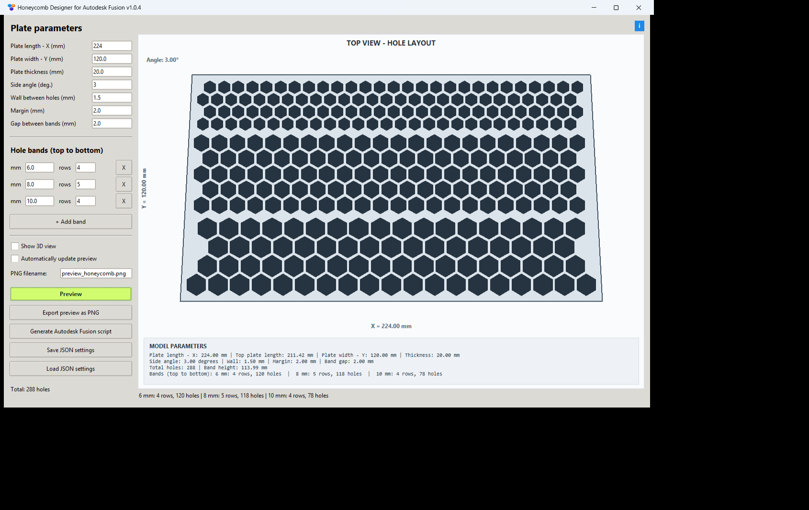
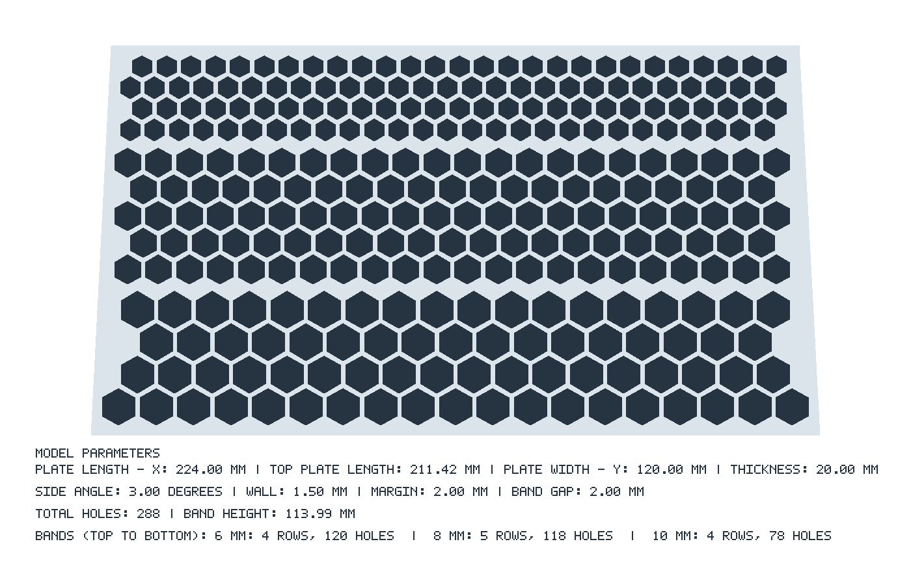

# Honeycomb Designer for Autodesk Fusion

**Version 1.0.4**

Honeycomb Designer is a lightweight desktop application for designing honeycomb patterns on a plate and generating a Python script that creates the corresponding 3D model in Autodesk Fusion.

The application is built with **Python and Tkinter** and uses only the Python standard library. No additional Python packages are required.

## Features

- Configure plate length, width, thickness, and side angle.
- Set wall thickness between openings and margins around the pattern.
- Create multiple bands of hexagonal openings, each with its own cell size and row count.
- Adjust the spacing between bands.
- Preview the generated layout from above (2D).
- Optionally enable a schematic 3D preview alongside the top view.
- Display model dimensions, band information, and opening counts.
- Export a PNG preview with model parameters.
- Generate a Python script for Autodesk Fusion to create the plate and cut through-holes.
- Save and load settings in JSON format.
- Optionally update the preview automatically as parameters change.
- Restore the last-used settings when the application starts.

## Requirements

- Python 3 with Tkinter support.
- A desktop environment capable of displaying Tkinter windows.
- **Autodesk Fusion** is required only to run the generated Fusion script, not to use the designer or export a PNG.

The application was designed for desktop use, including Windows. Tkinter is commonly included with standard Python installers, but its availability depends on the installation.

## Installation and launch

1. Download `honeycomb_designer_v1.0.4_EN.py` from this repository.
2. Place `honeycomb.png` in the same folder if you want the application icon and About-window image. The application can run without this image.
3. Open a terminal in that folder.
4. Run:

   ```bash
   python honeycomb_designer_v1.0.4_EN.py
   ```

   On Windows, you can alternatively use:

   ```powershell
   py honeycomb_designer_v1.0.4_EN.py
   ```

No `pip install` step is needed.

## How to use

## Screenshot




### 1. Set plate dimensions

Enter the required values in millimeters:

| Parameter | Meaning |
| --- | --- |
| Plate length - X | Length of the plate along the X axis |
| Plate width - Y | Width of the plate along the Y axis |
| Plate thickness | Thickness of the 3D plate |
| Side angle | Angle of the slanted plate sides, in degrees |
| Wall between openings | Spacing between adjacent hexagonal openings |
| Margin | Clearance between openings and the plate boundary |
| Gap between bands | Vertical separation between successive bands |

The application validates the geometry and reports invalid or oversized configurations.

### 2. Configure honeycomb bands

The bands are arranged **from top to bottom**. Each band has:

- **Cell size (mm)**: hexagonal opening size.
- **Rows**: number of rows in the band.

Use **Add band** to insert another band or **X** to remove one. The number of openings depends on the available plate area, dimensions, margins, and band configuration.

### 3. Preview the design

Click **Preview** to recalculate the pattern. The default view is from above.

Enable **Show 3D view** to display a schematic 3D preview next to the top view. Enable **Automatically update preview** to refresh the preview after changes to the parameters.

The preview also reports plate dimensions, side angle, total opening count, and band details.

### 4. Export a PNG preview

Click **Export preview as PNG**, choose a destination, and save the image. The exported PNG includes the pattern and a text summary of the model parameters and openings.

The PNG is an image preview, not a CAD model.



### 5. Generate a script for Autodesk Fusion

1. Click **Generate script for Autodesk Fusion**.
2. Save the generated `.py` file.
3. Open a design document in Autodesk Fusion.
4. In Fusion, open **Utilities > Scripts and Add-Ins**.
5. Add or select the generated script and run it using Fusion's script workflow.

The generated script creates the plate body and cuts the calculated hexagonal through-holes. The model geometry uses the same precomputed opening positions as the designer preview.

**Note:** The Fusion script must run inside Autodesk Fusion, where the `adsk` API is available. It cannot be run as a standalone Python program.

### 6. Save or restore settings

Use **Save settings JSON** to export the current configuration and **Load settings JSON** to restore a saved configuration.

The application also attempts to preserve your last-used settings automatically. On Windows, these are stored under the user's roaming application data directory in `HoneycombDesigner/settings.json`.

## Default configuration

| Setting | Default |
| --- | ---: |
| Plate length | 220 mm |
| Plate width | 120 mm |
| Plate thickness | 20 mm |
| Side angle | 1 degree |
| Wall thickness | 1.5 mm |
| Margin | 2 mm |
| Gap between bands | 2 mm |
| Band 1 | 6 mm, 4 rows |
| Band 2 | 8 mm, 5 rows |
| Band 3 | 10 mm, 4 rows |
| 3D preview | Off |

The application has a maximum of **1,500 candidate openings** per layout.

## Troubleshooting

**The application icon does not appear**  
Make sure `honeycomb.png` is available alongside the Python script. The icon is optional.

**The pattern does not fit**  
Try reducing the number of rows, cell sizes, band gaps, or margins, or increase the plate dimensions. The application displays a validation message when a configuration is invalid.

**The Fusion script cannot import `adsk`**  
Run the generated script inside Autodesk Fusion, not in your normal Python interpreter.

**The PNG does not look like the 3D preview**  
The PNG export represents the top-view geometry and includes a parameter summary. The optional 3D preview is a separate schematic visualization.

## Project information

- **Application:** Honeycomb Designer for Autodesk Fusion
- **Version:** 1.0.4
- **Author:** Matus Kolcun (SK)
- **Created with:** ChatGPT, Perplexity and Gemini

## License

No license has been specified in this README. If you want others to reuse, modify, or redistribute the code under defined terms, add a `LICENSE` file and update this section accordingly.

## Disclaimer

This is an independent utility and is not an official Autodesk product. Verify generated geometry in Autodesk Fusion before manufacturing or using it in a safety-critical application.

